# Práctica: Instalación de WordPress en Ubuntu 24.04 (nuestro LAMP en marcha)
| | |
| **Alumno** | Daviti Gvaramia |
| **Ciclo** | Sistemas Microinformáticos y Redes (SMR) |
| **Módulo** | Aplicaciones Web |
| **Fecha** | 28/10/2026 |


## Índice

1. [Conexión por SSH y comprobación del servidor](#apartado-1-conexión-por-ssh-y-comprobación-del-servidor)
2. [Dejar Apache con un único sitio](#apartado-2-dejar-apache-con-un-único-sitio)
3. [Crear la base de datos de WordPress](#apartado-3-crear-la-base-de-datos-de-wordpress)
4. [Descargar e instalar los ficheros de WordPress](#apartado-4-descargar-e-instalar-los-ficheros-de-wordpress)
5. [Terminar la instalación desde el navegador](#apartado-5-terminar-la-instalación-desde-el-navegador)
6. [Comprobamos que WordPress funciona](#apartado-6-comprobamos-que-wordpress-funciona)
7. [Para que no se rompa si cambia la IP](#apartado-7-para-que-no-se-rompa-si-cambia-la-ip)
8. [Dos ajustes para trabajar cómodamente](#apartado-8-dos-ajustes-para-trabajar-cómodamente)
9. [¿Qué pasa si MariaDB se para?](#apartado-9-qué-pasa-si-mariadb-se-para)
10. [Comprobación final](#apartado-10-comprobación-final)
11. [Conclusiones y problemas encontrados](#conclusiones-y-problemas-encontrados)

---

## Apartado 1. Conexión por SSH y comprobación del servidor

### 1.1. Averiguar la IP del servidor

```bash
hostname -I
```

La salida muestra varias direcciones. La que uso para conectarme desde mi ordenador es **192.168.56.18** (la red solo-anfitrión de la máquina virtual).

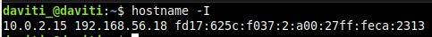

> **Explicación:** Con `hostname -I` averiguo las IPs del servidor; uso la 192.168.56.18 para conectarme desde mi ordenador.

**Qué hace y por qué:** `hostname -I` lista todas las direcciones IP del servidor. Necesito saber la IP para poder conectarme por SSH y, más adelante, abrir WordPress en el navegador.

### 1.2. Conectarme por SSH desde mi ordenador

```bash
ssh daviti_@192.168.56.18
```

Me pide la contraseña de mi usuario (no se ve al escribirla) y, al entrar, aparece el mensaje de bienvenida de Ubuntu 24.04.5 LTS.

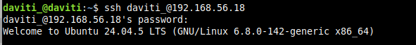

> **Explicación:** Me conecto al servidor por SSH con mi usuario; al entrar aparece el mensaje de bienvenida de Ubuntu 24.04.

**Qué hace y por qué:** `ssh usuario@IP` abre una terminal remota en el servidor. Como el servidor no tiene pantalla ni escritorio, desde aquí escribiré todos los comandos de la práctica.

### 1.3. Comprobar que todo lo anterior sigue funcionando

```bash
systemctl is-active apache2 mariadb
php -v
```

Resultado: `active` dos veces (Apache y MariaDB funcionan) y PHP 8.3.6.

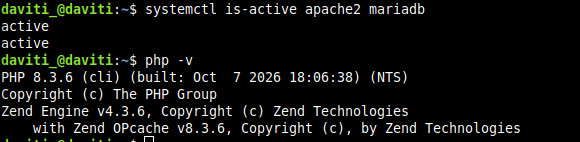

> **Explicación:** Compruebo que Apache y MariaDB están `active` y que PHP es la versión 8.3, es decir, que el LAMP anterior sigue funcionando.

**Qué hace y por qué:** `systemctl is-active` indica si cada servicio está en marcha y `php -v` muestra la versión de PHP. Compruebo que la base (el LAMP de las prácticas anteriores) está bien antes de instalar nada encima.

### ❓ ¿Qué dos "puertas" (programas y puertos) usas para trabajar con el servidor y para qué sirve cada una?

- **SSH (puerto 22), con el programa `ssh` en la terminal:** sirve para **administrar** el servidor en modo texto: instalar paquetes, copiar ficheros, configurar y dar permisos.
- **HTTP (puerto 80), con el navegador:** sirve para **usar** WordPress de forma gráfica: ver la web, terminar el asistente de instalación y entrar al panel de administración.

---

## Apartado 2. Dejar Apache con un único sitio

### 2.1. Cambiar los sitios activos

```bash
sudo a2dissite sitio1.conf sitio2.conf
sudo a2ensite 000-default.conf
sudo apache2ctl configtest
sudo systemctl reload apache2
```

Se desactivan `sitio1` y `sitio2`. El sitio por defecto ya estaba activado (`already enabled`) y `configtest` responde **Syntax OK**.

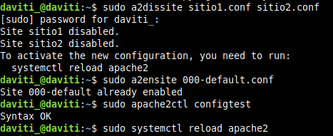

> **Explicación:** Desactivo `sitio1` y `sitio2` con `a2dissite`, el sitio por defecto ya estaba activo y `configtest` da `Syntax OK` antes de recargar Apache.

**Qué hace cada comando:**

- `a2dissite` desactiva los sitios indicados (quita su enlace de `sites-enabled`), sin borrar sus ficheros.
- `a2ensite` activa el sitio por defecto, cuya carpeta es `/var/www/html`.
- `apache2ctl configtest` revisa que la configuración no tenga errores antes de aplicarla.
- `systemctl reload apache2` recarga la configuración sin cortar el servicio.

**Aviso del `ServerName`:** Apache avisa de que no tiene un nombre de servidor global definido. Lo soluciono así:

```bash
echo "ServerName localhost" | sudo tee /etc/apache2/conf-available/servername.conf
sudo a2enconf servername
sudo apache2ctl configtest
sudo systemctl reload apache2
```

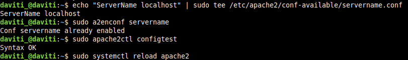

> **Explicación:** Defino `ServerName localhost` para quitar el aviso de Apache por no tener nombre de servidor global; `configtest` vuelve a dar `Syntax OK`.

Con esto `configtest` solo muestra `Syntax OK`. (En mi caso la configuración `servername` ya estaba habilitada de antes.)

### 2.2. Comprobar que solo hay un sitio activo y qué carpeta usa

```bash
ls /etc/apache2/sites-enabled/
grep DocumentRoot /etc/apache2/sites-enabled/000-default.conf
```

Solo aparece `000-default.conf` y su `DocumentRoot` es `/var/www/html`.

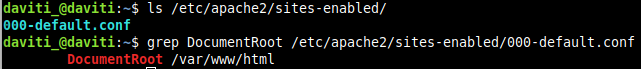

> **Explicación:** Solo queda activo `000-default.conf` y su `DocumentRoot` es `/var/www/html`, donde irá WordPress.

### 2.3. Comprobar que el navegador llega al servidor

Abro `http://192.168.56.18` en el navegador de mi ordenador y aparece el contenido de la primera práctica: **"Servidor de DAVITI"**.

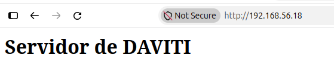

> **Explicación:** Desde el navegador de mi ordenador entro por la IP del servidor y veo la página por defecto ("Servidor de DAVITI").

### ❓ ¿Qué diferencia hay entre desactivar un sitio con `a2dissite` y borrar sus ficheros? ¿Por qué ahora ves la página por defecto y antes veías sitio1?

`a2dissite` solo **desactiva** el sitio: elimina el enlace en `sites-enabled`, pero los ficheros y la configuración siguen en su sitio y puedo reactivarlo cuando quiera con `a2ensite`. Borrar los ficheros destruye el sitio y no se puede recuperar.

Antes veía `sitio1` porque estaba activado y respondía a su nombre (`sitio1.local`). Ahora solo está activo el sitio por defecto, que es el que responde cuando entro por la IP, y su carpeta es `/var/www/html`.

---

## Apartado 3. Crear la base de datos de WordPress

Entro en MariaDB como administrador y creo la base de datos, el usuario y sus permisos:

```bash
sudo mariadb
```

```sql
CREATE DATABASE wordpress;
CREATE USER 'wp_user'@'localhost' IDENTIFIED BY '********';
GRANT ALL ON wordpress.* TO 'wp_user'@'localhost';
exit
```

Cada orden responde `Query OK`:

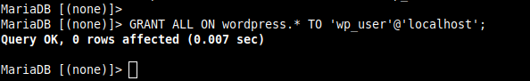

> **Explicación:** Creo los permisos de la base de datos: `GRANT ALL` da a `wp_user` acceso total solo a la base `wordpress`.

| Orden | Qué hace |
|---|---|
| `CREATE DATABASE wordpress;` | Crea el "armario" donde WordPress guardará todos sus datos |
| `CREATE USER 'wp_user'@'localhost' IDENTIFIED BY '...';` | Crea la "llave" (usuario) y le pone contraseña; solo puede usarse desde el propio servidor |
| `GRANT ALL ON wordpress.* TO 'wp_user'@'localhost';` | Da a esa llave permiso total, pero solo sobre la base `wordpress` |

### Comprobar que la llave funciona

```bash
mariadb -u wp_user -p wordpress
```

Tras escribir la contraseña (no se ve), aparece el prompt `MariaDB [wordpress]>`, así que el usuario funciona.

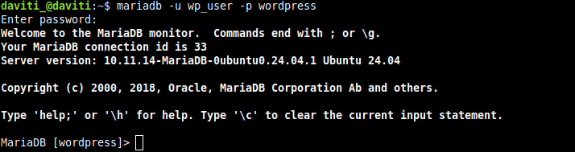

> **Explicación:** Entro con `wp_user` y aparece el prompt `MariaDB [wordpress]>`, lo que confirma que el usuario y la base funcionan.

### ❓ ¿Por qué WordPress usa su propio usuario `wp_user` con permiso solo sobre su base y no el usuario `root` de MariaDB?

Por **seguridad (mínimo privilegio)**. `root` puede hacer cualquier cosa en todo el servidor de bases de datos. Si WordPress usara `root` y alguien aprovechara un fallo de WordPress o de un plugin, podría leer, modificar o borrar **todas** las bases de datos. Con `wp_user`, el daño se limita a la base `wordpress`. Además, la contraseña de `root` no queda escrita en `wp-config.php`.

---

## Apartado 4. Descargar e instalar los ficheros de WordPress

### 4.1. Descargar y descomprimir WordPress

```bash
sudo apt install wget -y
cd /tmp
wget https://wordpress.org/latest.tar.gz
tar -xzf latest.tar.gz
ls wordpress
```

`wget` ya estaba instalado. Se descarga `latest.tar.gz` (unos 34 MB), se descomprime y `ls wordpress` muestra `index.php`, `wp-admin`, `wp-content`, `wp-config-sample.php`...

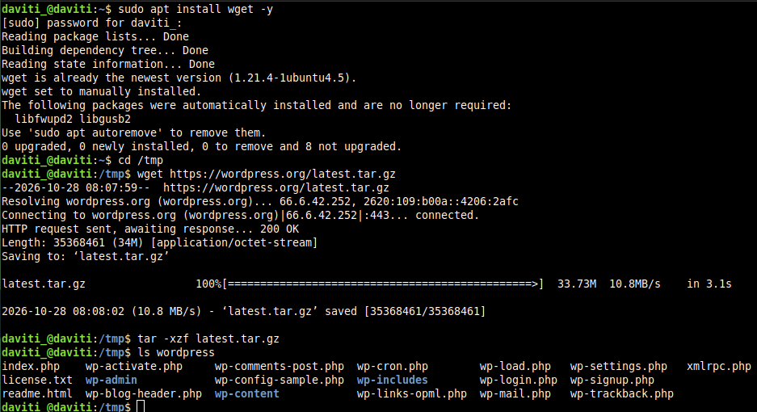

> **Explicación:** Instalo `wget`, descargo `latest.tar.gz` de WordPress en `/tmp`, lo descomprimo y listo su contenido.

### 4.2. Colocarlo en la carpeta del sitio

```bash
sudo rm /var/www/html/index.html
sudo cp -a /tmp/wordpress/. /var/www/html/
rm -r /tmp/wordpress /tmp/latest.tar.gz
ls /var/www/html
```

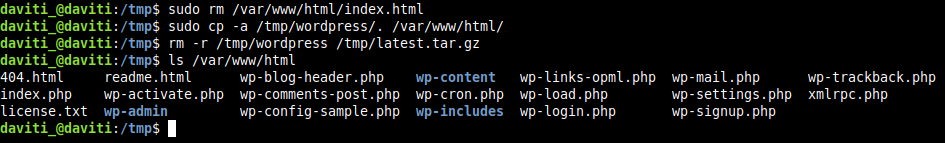

> **Explicación:** Borro el `index.html` de Apache, copio WordPress a `/var/www/html` y limpio los ficheros temporales.

Compruebo con `curl` que el servidor ya sirve WordPress y no la página anterior:

```bash
curl -I http://localhost
```

La respuesta es un `302 Found` hacia `/wp-admin/setup-config.php`, es decir, WordPress ya está respondiendo y me lleva a su instalador.

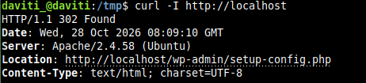

> **Explicación:** Con `curl -I` veo que el servidor responde con una redirección (302) al instalador de WordPress, así que ya sirve WordPress.

### ❓ Explica qué hace cada uno de los comandos que acabas de ejecutar.

| Comando | Qué hace |
|---|---|
| `sudo apt install wget -y` | Instala `wget` (herramienta para descargar ficheros desde la terminal); `-y` responde "sí" automáticamente |
| `cd /tmp` | Entro en la carpeta temporal para no ensuciar mi carpeta personal |
| `wget https://wordpress.org/latest.tar.gz` | Descarga la última versión de WordPress comprimida |
| `tar -xzf latest.tar.gz` | Descomprime el fichero (`x` extraer, `z` gzip, `f` fichero) y crea la carpeta `wordpress` |
| `ls wordpress` | Lista el contenido para comprobar que se ha descomprimido bien |
| `sudo rm /var/www/html/index.html` | Borra la página de bienvenida de Apache, que si no tendría prioridad sobre WordPress |
| `sudo cp -a /tmp/wordpress/. /var/www/html/` | Copia todo el contenido de WordPress a la carpeta del sitio, conservando atributos (`-a`) e incluyendo ficheros ocultos (el `.` final) |
| `rm -r /tmp/wordpress /tmp/latest.tar.gz` | Borra la carpeta y el comprimido temporales, que ya no hacen falta |
| `ls /var/www/html` | Comprueba que los ficheros de WordPress están en su sitio |
| `curl -I http://localhost` | Pide solo las cabeceras de la web para ver qué responde el servidor |

### 4.3. Dar los permisos correctos

```bash
sudo chown -R www-data:www-data /var/www/html
sudo find /var/www/html -type d -exec chmod 755 {} \;
sudo find /var/www/html -type f -exec chmod 644 {} \;
ls -ld /var/www/html
```

El propietario y el grupo de `/var/www/html` son ahora `www-data www-data`.

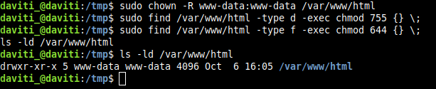

> **Explicación:** Cambio el propietario a `www-data` y dejo carpetas en 755 y ficheros en 644 para que WordPress pueda escribir.

### ❓ Explica qué hace cada orden. ¿Por qué hay que cambiar el propietario a `www-data`? ¿Qué podría fallar si siguiera siendo mi usuario?

- `chown -R www-data:www-data /var/www/html`: cambia el propietario y el grupo de la carpeta y de todo su contenido (`-R`, recursivo) a `www-data`.
- `find ... -type d -exec chmod 755 {} \;`: a todas las **carpetas** les pone permisos `755` (el propietario lee, escribe y entra; el resto solo lee y entra).
- `find ... -type f -exec chmod 644 {} \;`: a todos los **ficheros** les pone `644` (el propietario lee y escribe; el resto solo lee).
- `ls -ld /var/www/html`: muestra los permisos y el propietario de la carpeta para comprobarlo.

Apache se ejecuta con el usuario `www-data`, así que WordPress también. Si la carpeta siguiera siendo de mi usuario, con permisos `755` `www-data` solo podría **leer**, no escribir. Fallarían cosas como crear `wp-config.php`, subir imágenes, instalar plugins o temas, actualizar WordPress o generar el `.htaccess`.

---

## Apartado 5. Terminar la instalación desde el navegador

Abro `http://192.168.56.18` y aparece el asistente de instalación de WordPress. Elijo idioma Español, pulso *¡Vamos a ello!* y relleno los datos de la base de datos.

### Pantalla 3: datos de la base de datos

| Campo | Valor |
|---|---|
| Nombre de la base de datos | `wordpress` |
| Nombre de usuario | `wp_user` |
| Contraseña | `********` |
| Servidor de la base de datos | `localhost` |
| Prefijo de tabla | `wp_` |

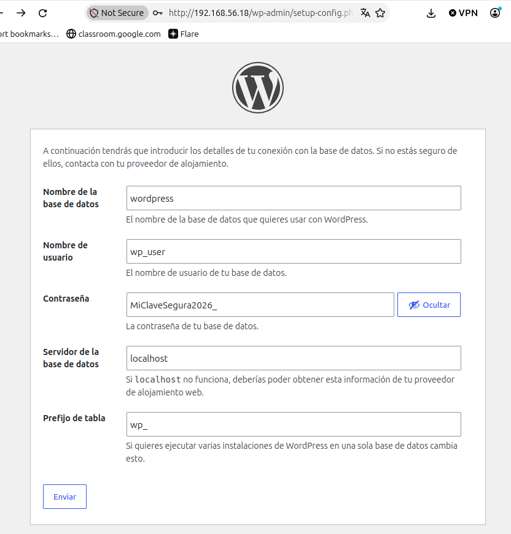

> **Explicación:** Pantalla 3 del instalador: introduzco base `wordpress`, usuario `wp_user`, servidor `localhost` y prefijo `wp_` (contraseña tapada).

WordPress comprueba que puede conectarse y crea él solo el fichero `wp-config.php`:

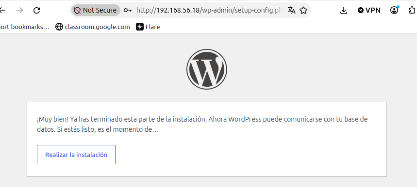

> **Explicación:** WordPress confirma que ya puede comunicarse con la base de datos y me ofrece realizar la instalación.

### Pantalla 5: datos del sitio

| Campo | Valor |
|---|---|
| Título del sitio | Sitio de Daviti |
| Nombre de usuario | Daviti (no uso `admin`) |
| Contraseña | `********` (fuerte, la propuesta por WordPress) |
| Correo electrónico | daviti@ejemplo.local |
| Visibilidad en buscadores | Marcado *Disuadir a los motores de búsqueda* |

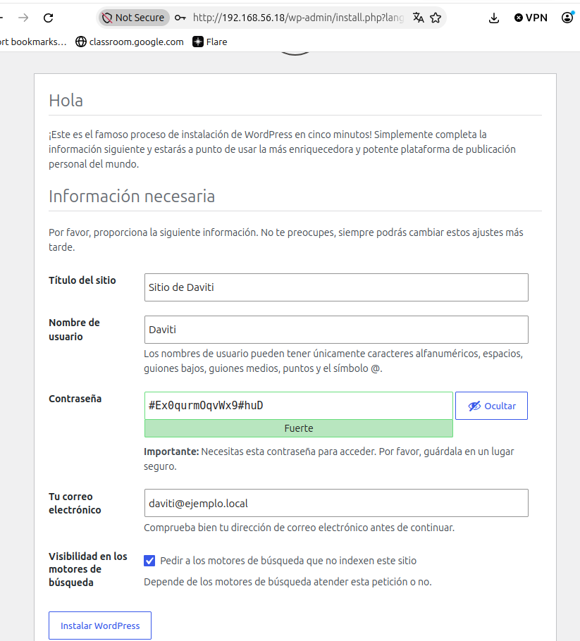

> **Explicación:** Pantalla 5: elijo título, usuario (no `admin`), contraseña fuerte (tapada), correo y marco no indexar en buscadores.

Al pulsar *Instalar WordPress* aparece la pantalla de éxito:

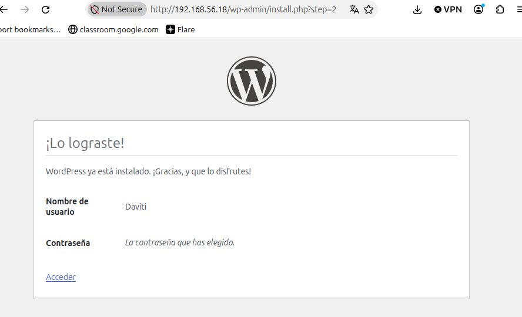

> **Explicación:** WordPress me avisa de que la instalación ha terminado con éxito y me deja acceder al panel.

Inicio sesión con el usuario y la contraseña que acabo de crear y entro en el panel de administración.

**Qué ha pasado por debajo:** al enviar la pantalla 3, WordPress comprobó que podía entrar en la base de datos y creó solo su `wp-config.php`. En la pantalla 5 creó las tablas en MariaDB y mi usuario administrador.

### ❓ ¿Qué partes de la instalación has hecho en la terminal y cuáles en el navegador? ¿Por qué el servidor no necesita interfaz gráfica?

- **En la terminal (SSH):** preparar Apache, crear la base de datos y el usuario, descargar WordPress, copiarlo a `/var/www/html` y darle permisos.
- **En el navegador:** terminar la instalación con el asistente (idioma, datos de la base de datos, título, usuario y contraseña) y usar el panel de WordPress.

El servidor no necesita interfaz gráfica porque **WordPress es una web, no un programa que se abra en el servidor**. El servidor solo envía páginas (texto con instrucciones de cómo dibujarlas) y es el **navegador de mi ordenador** el que las dibuja.

---

## Apartado 6. Comprobamos que WordPress funciona

### 6.1 a 6.3. Web pública, panel y entrada de prueba

Entro en `http://192.168.56.18` y se ve mi sitio, **"Sitio de Daviti"**. Desde el panel (`/wp-admin`) publico una entrada de prueba con mi nombre y la fecha, y aparece en la portada junto a la entrada de ejemplo "¡Hola, mundo!". Se ve también la barra de administración porque tengo la sesión iniciada.

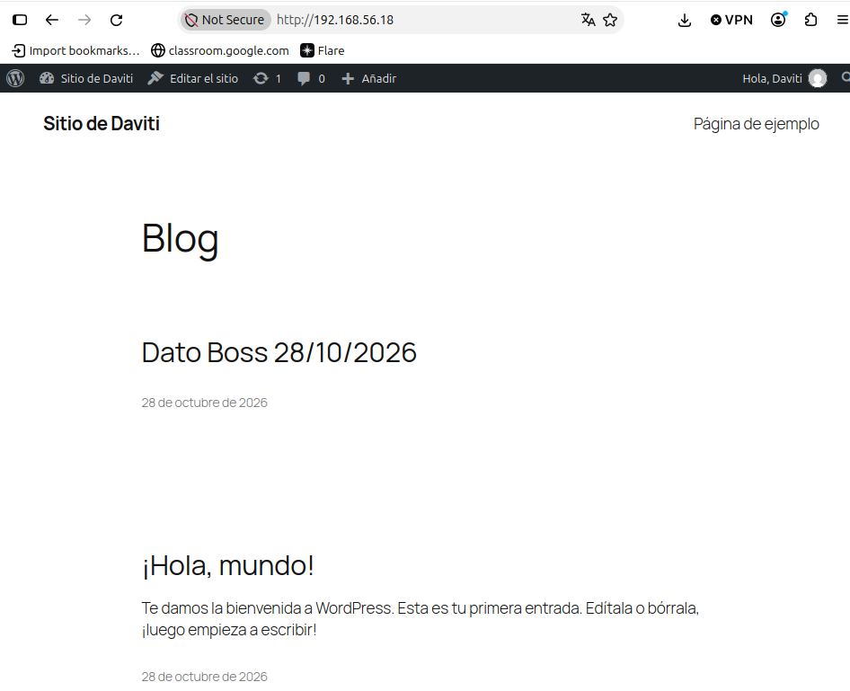

> **Explicación:** La web pública ya funciona con el título que elegí y muestra la entrada de prueba que publiqué junto a "¡Hola, mundo!".

### 6.4. ¿Dónde ha guardado WordPress mi entrada?

```bash
sudo mariadb wordpress -e "SHOW TABLES;"
```

Aparecen las 12 tablas que creó WordPress, todas con el prefijo `wp_`:

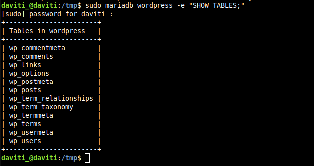

> **Explicación:** `SHOW TABLES` lista las 12 tablas `wp_` que WordPress creó en la base de datos, donde guarda entradas, usuarios y ajustes.

- `wp_posts` guarda las entradas y páginas.
- `wp_users` guarda los usuarios.
- `wp_options` guarda la configuración del sitio.

### 6.5. Dónde está cada cosa

| Qué | Dónde |
|---|---|
| Los ficheros de WordPress | `/var/www/html/` |
| La conexión con la base de datos | `/var/www/html/wp-config.php` (no se comparte nunca: contiene la contraseña) |
| Temas, plugins e imágenes subidas | `/var/www/html/wp-content/` (`themes`, `plugins`, `uploads`) |
| Entradas, usuarios y ajustes | En la base de datos `wordpress` de MariaDB |

### ❓ ¿Dónde guarda WordPress las entradas: en ficheros del servidor o en la base de datos? ¿Cómo lo has comprobado?

Las guarda en la **base de datos** (principalmente en la tabla `wp_posts`), no en ficheros. Lo comprobé listando las tablas de la base `wordpress` con `SHOW TABLES;`, donde aparecen `wp_posts`, `wp_users` y `wp_options`, entre otras, y viendo que en `/var/www/html` solo están los ficheros del programa, no el texto de mis entradas.

---

## Apartado 7. Para que no se rompa si cambia la IP

WordPress apunta en su base de datos la dirección con la que se instaló. Si la IP de la máquina virtual cambia, la web se vería sin diseño y el panel llevaría a una dirección que ya no existe. Para evitarlo edito la configuración:

```bash
sudo nano /var/www/html/wp-config.php
```

Justo antes de la línea `/* That's all, stop editing! */` añado estas dos líneas:

```php
define( 'WP_HOME', 'http://' . $_SERVER['HTTP_HOST'] );
define( 'WP_SITEURL', 'http://' . $_SERVER['HTTP_HOST'] );
```

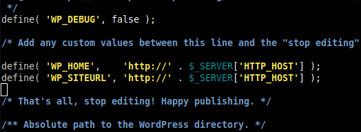

> **Explicación:** Añado `WP_HOME` y `WP_SITEURL` en `wp-config.php` para que WordPress use siempre la dirección con la que lo visitan, aunque cambie la IP.

Compruebo que no hay errores de sintaxis:

```bash
php -l /var/www/html/wp-config.php
```

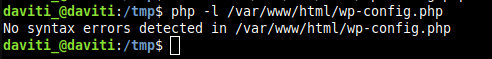

> **Explicación:** `php -l` comprueba que `wp-config.php` no tiene errores de sintaxis tras editarlo.

**Qué hace y por qué:** `WP_HOME` y `WP_SITEURL` le dicen a WordPress que use siempre la dirección (`HTTP_HOST`) con la que le están visitando, en lugar de la que quedó guardada al instalar. Es cómodo para un laboratorio; en un servidor real se escribiría la dirección fija del sitio. `php -l` revisa la sintaxis del fichero para no dejar la web rota por un error al editarlo.

---

## Apartado 8. Dos ajustes para trabajar cómodamente

### 8.1. Direcciones "bonitas" (enlaces permanentes)

Creo la configuración que permite a Apache leer el `.htaccess` en la carpeta de WordPress:

```bash
sudo nano /etc/apache2/conf-available/wordpress.conf
```

```apache
<Directory /var/www/html>
    AllowOverride All
</Directory>
```

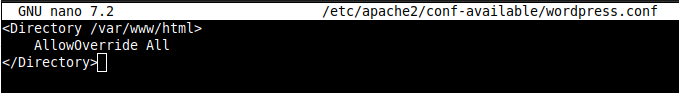

> **Explicación:** Creo `wordpress.conf` con `AllowOverride All` para que Apache lea el `.htaccess` de WordPress.

La activo:

```bash
sudo a2enmod rewrite
sudo a2enconf wordpress
sudo apache2ctl configtest
sudo systemctl restart apache2
```

El módulo `rewrite` ya estaba activo, se habilita la configuración `wordpress` y `configtest` responde `Syntax OK`.

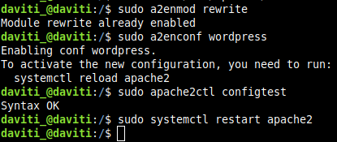

> **Explicación:** Activo `rewrite` y la configuración `wordpress`, compruebo con `configtest` y reinicio Apache.

Después, en el panel de WordPress: *Ajustes → Enlaces permanentes → Nombre de la entrada → Guardar cambios*. Las direcciones pasan a ser del estilo `http://192.168.56.18/pagina-ejemplo/`.

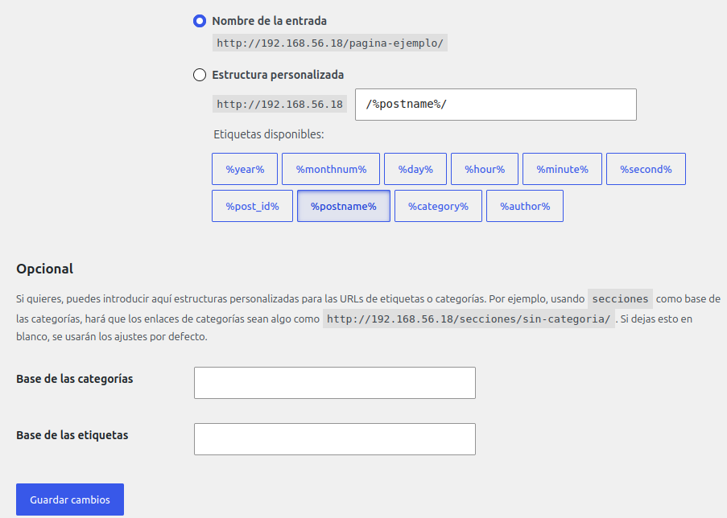

> **Explicación:** En Ajustes → Enlaces permanentes elijo "Nombre de la entrada" para tener direcciones claras como `/pagina-ejemplo/`.

WordPress ha creado solo el fichero `.htaccess`:

```bash
ls -la /var/www/html/.htaccess
```

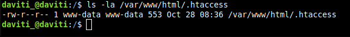

> **Explicación:** WordPress ha creado solo el fichero `.htaccess` (propiedad de `www-data`) al guardar los enlaces permanentes.

### 8.2. Poder subir ficheros grandes

PHP, por defecto, solo permite subir ficheros de 2 MB. Subo el límite a 64 MB:

```bash
printf 'upload_max_filesize = 64M\npost_max_size = 64M\n' | sudo tee /etc/php/8.3/apache2/conf.d/99-wordpress.ini
sudo systemctl restart apache2
```

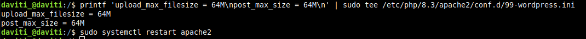

> **Explicación:** Subo el límite de subida de PHP a 64 MB escribiendo `upload_max_filesize` y `post_max_size` en un `.ini` propio y reinicio Apache.

**Qué hace y por qué:** `printf` escribe las dos directivas en un fichero propio de configuración de PHP (`99-wordpress.ini`) y `tee` lo guarda con permisos de administrador. Se reinicia Apache para que PHP cargue el cambio. `upload_max_filesize` es el tamaño máximo de un fichero y `post_max_size` el máximo de datos de la petición, que debe ser al menos igual.

### ❓ ¿Por qué las direcciones "bonitas" dan error 404 si Apache no tiene permitido leer el fichero `.htaccess`?

Las direcciones bonitas como `/pagina-ejemplo/` no corresponden a ningún fichero real del servidor. WordPress usa en el `.htaccess` unas reglas de reescritura que redirigen cualquier dirección a `index.php`, y este decide qué contenido mostrar. Si Apache tiene `AllowOverride None` (lo predeterminado), **ignora el `.htaccess`**, no aplica esas reglas, busca un fichero o carpeta con ese nombre, no lo encuentra y devuelve **404**.

---

## Apartado 9. ¿Qué pasa si MariaDB se para?

WordPress depende de MariaDB. Detengo la base de datos a propósito:

```bash
sudo systemctl stop mariadb
```

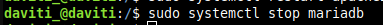

> **Explicación:** Detengo MariaDB a propósito para ver cómo afecta a WordPress.

Al recargar `http://192.168.56.18` aparece el error **"Error establishing a database connection"**:

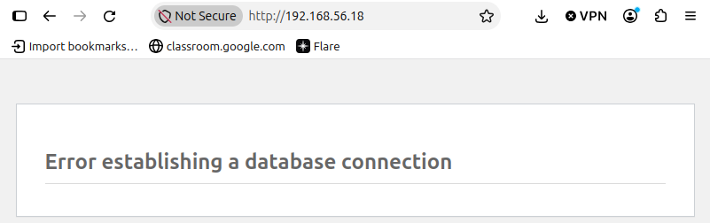

> **Explicación:** Sin MariaDB, WordPress no puede mostrar nada y da "Error establishing a database connection".

Arranco MariaDB de nuevo y compruebo que está activa:

```bash
sudo systemctl start mariadb
systemctl is-active mariadb
```

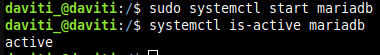

> **Explicación:** Arranco MariaDB de nuevo y `is-active` confirma que vuelve a estar `active`, con lo que la web se recupera.

Al recargar la web vuelve a funcionar.

### ❓ Cuando WordPress muestra "Error al establecer una conexión con la base de datos", ¿qué dos cosas comprobarías y en qué orden?

1. **Si MariaDB está en marcha:** `systemctl is-active mariadb` (y, si no lo está, `sudo systemctl start mariadb`).
2. **Si el usuario y la contraseña siguen siendo correctos:** probando a entrar con `mariadb -u wp_user -p wordpress`.

---

## Apartado 10. Comprobación final

```bash
systemctl is-active apache2 mariadb
php -v
ls /etc/apache2/sites-enabled/
sudo mariadb wordpress -e "SHOW TABLES;"
```

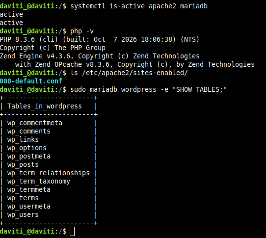

> **Explicación:** Comprobación final: Apache y MariaDB activos, PHP 8.3, un único sitio en Apache y las 12 tablas de WordPress.

### Estado final del servidor

| Pieza | Programa | Estado |
|---|---|---|
| Linux | Ubuntu 24.04 | Instalado |
| Apache | Apache2, con un único sitio | Funcionando |
| MariaDB | MariaDB 10.11 | Funcionando, con la base `wordpress` |
| PHP | PHP 8.3 | Funcionando |
| WordPress | Instalado en `/var/www/html` | Funcionando y accesible desde el navegador |

### Datos de acceso

| Dato | Valor |
|---|---|
| Dirección de la web | `http://192.168.56.18` |
| Panel de administración | `http://192.168.56.18/wp-admin` |
| Usuario administrador | Daviti |
| Contraseña | `********` |

---

## Conclusiones y problemas encontrados

**Conclusiones**

- WordPress no es un programa que se abra en el servidor, sino una web: el servidor la prepara y sirve, y el navegador de mi ordenador la dibuja. Por eso el servidor Ubuntu no necesita escritorio.
- Aprendí a repartir el trabajo entre las dos "puertas": SSH para administrar en texto y HTTP para usar WordPress en el navegador.
- Entendí la importancia de usar un usuario de base de datos propio con permisos limitados y de dar los permisos de ficheros correctos a `www-data`.
- Vi que todo el contenido de WordPress vive en la base de datos y que, sin MariaDB, la web deja de funcionar.

**Problemas encontrados y cómo los resolví**

- **Aviso de `ServerName` en Apache:** `configtest` puede avisar de que Apache no tiene un nombre de servidor global. Se soluciona creando `servername.conf` con `ServerName localhost` y habilitándolo con `a2enconf`; en mi servidor esa configuración ya estaba habilitada y `configtest` responde solo `Syntax OK`.
- **Posible página antigua en lugar de WordPress:** al copiar WordPress hay que borrar antes el `index.html` de `/var/www/html`, y se comprueba con `curl -I http://localhost`, que en mi caso responde con una redirección (`302`) al instalador de WordPress.
- **Contraseñas en las capturas:** las capturas de las pantallas 3 y 5 del instalador mostraban las contraseñas, así que las tapé antes de subirlas al repositorio y escribí `********` en la memoria.
